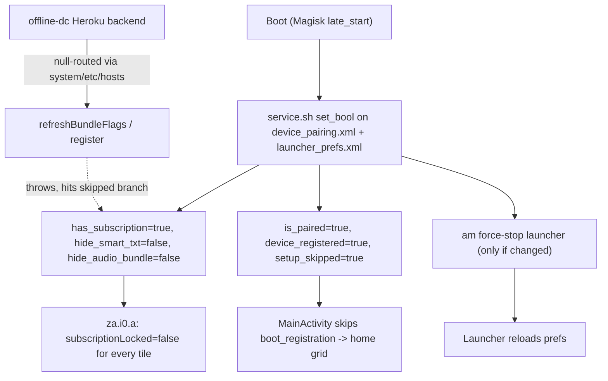

# tcl-flip-2-apps

Notes, APKs, and tooling from reverse-engineering and re-customizing my TCL Flip 2
(model `4058G`, Android 11 / SDK 30, rooted with Magisk).

The phone runs a locked-down home screen from a shuttered business, **DumbDown Launcher**
(`com.offlineinc.dumbdownlauncher`), plus two companion apps I also built. This repo is
where I figure out how that launcher works and undo the parts that depend on a backend
that no longer exists. It is not a full-device backup; only the three offlineinc apps and
their analysis live here.

## Layout

| Path | What it is |
| --- | --- |
| `apks/` | The three offlineinc APKs pulled off the device (Git LFS). |
| `decomp/` | jadx output for `com.offlineinc.dumbdownlauncher` — the reference for the findings below. |
| `magisk/launcher/` | Magisk module that re-enables the plan gate and the boot SIM-check without touching app code. |
| `magisk/bootanim/` | Magisk module that swaps in the offlineinc boot animation shipped in the APK. |

### The apps

| Package | App | Notes |
| --- | --- | --- |
| `com.offlineinc.dumbdownlauncher` | DumbDown Launcher | The `HOME` launcher; runs an accessibility service that polices other apps. |
| `com.offlineinc.dumbtt9` | DumbTT9 | T9 keyboard companion. |
| `com.offlineinc.voicetotext` | Voice to Text | Dictation companion. |

## The "This feature isn't on your plan" gate

DumbDown Launcher decides which app tiles you can open based on three booleans stored in its
`device_pairing` SharedPreferences. Those booleans were fetched from a backend that paired
each device to a subscription plan. That backend
(`offline-dc-backend-ba4815b2bcc8.herokuapp.com`) is gone, so the flags never get set to
their "paid" values and paid tiles show "This feature isn't on your plan."

### Where the decision is made

[`decomp/.../za/i0.java`](decomp/com.offlineinc.dumbdownlauncher/sources/za/i0.java) computes a
`subscriptionLocked` flag for every tile, grouping packages into three bundles:

- **essentials** (`f11539a`): `com.whatsapp`, `com.ubercab.uberlite`,
  `org.thoughtcrime.securesms`, `com.azure.authenticator`, plus built-ins `__CONTACT_SYNC__`,
  `__DUMB_MAP__`, `__QUACK__`, `__SNAKE__`, `__WEATHER__`.
- **audio** (`f11540b`): `com.spotify.music`, `com.apple.android.music`,
  `de.danoeh.antennapod`, `__DUMB_PODCAST__`.
- **smart text** (`f11541c`): `com.openbubbles.messaging`, `__GOOGLE_MESSAGES__`.

A tile is locked unless one of these holds:

```32:34:decomp/com.offlineinc.dumbdownlauncher/sources/za/i0.java
            if (sharedPreferences.getBoolean("has_subscription", true) || (!f11539a.contains(packageName) && ((sharedPreferences.getBoolean("hide_audio_bundle", false) || !f11540b.contains(packageName)) && (sharedPreferences.getBoolean("hide_smart_txt", false) || !f11541c.contains(packageName))))) {
                z3 = false;
            }
```

In plain terms, a tile stays **unlocked** when `has_subscription == true` (unlocks
everything), or the package is in no bundle, or it is in the audio/smart-text bundle but the
matching `hide_*` flag is `true`. The `hide_*` flags are inverted: when a bundle is *removed*
from a plan the app sets its `hide_*` flag `true`, so those tiles fall through to "not gated"
rather than "locked." The clean unlock is therefore `has_subscription=true` with both
`hide_*` flags `false`.

### Where the flags come from

[`decomp/.../cc/b.java`](decomp/com.offlineinc.dumbdownlauncher/sources/cc/b.java)
(`DeviceRegistrar`) resolves the SIM's phone number, registers the device, then calls
`refreshBundleFlags`, which reads the plan from the backend
([`decomp/.../zb/b.java`](decomp/com.offlineinc.dumbdownlauncher/sources/zb/b.java)) and writes
the three flags. Two failure modes matter:

- **404 (phone not found):** it defaults to the *unlocked* values
  (`hasSubscription=true`, both `hide_*` false).
- **Any other error (network/DNS failure):** it returns early and leaves the existing flags
  untouched — the "skipped" branch.

```243:246:decomp/com.offlineinc.dumbdownlauncher/sources/cc/b.java
        } catch (Exception e10) {
            Log.w("DeviceRegistrar", "refreshBundleFlags: skipped (" + e10.getMessage() + ")");
            return;
        }
```

That "skipped" branch is what makes a fix durable: if the backend host can't be reached at
all, the refresh throws and any values we wrote survive.

## The boot SIM-check / activation loop

On every boot (or launcher restart) the phone can show an activation screen that steps through
"waiting for ur sim..." → "finishing sim registration..." → "activating ur phone..." →
"checking bundle...", then fails with "sorry, we couldn't connect to the network." Like the
plan gate, this is backend-driven and can never succeed now.

### How it is chosen and what runs

[`MainActivity`](decomp/com.offlineinc.dumbdownlauncher/sources/com/offlineinc/dumbdownlauncher/MainActivity.java)
picks an onboarding "step" on launch. The activation screen is the `"boot_registration"` step,
selected from `device_pairing` flags and only when `launcher_prefs.setup_skipped` is false:

```380:383:decomp/com.offlineinc.dumbdownlauncher/sources/com/offlineinc/dumbdownlauncher/MainActivity.java
        if (!getSharedPreferences("launcher_prefs", r13).getBoolean("setup_skipped", r13)) {
            if (z13 || z14) {
                i11 = 0;
                str3 = "boot_registration";
```

where `z13`/`z14` reduce to "not paired and not registered." The screen itself
([`jd/a.java`](decomp/com.offlineinc.dumbdownlauncher/sources/jd/a.java), state enum
[`hc/q.java`](decomp/com.offlineinc.dumbdownlauncher/sources/hc/q.java)) drives a coroutine
([`d1/w2.java`](decomp/com.offlineinc.dumbdownlauncher/sources/d1/w2.java)) that calls
`hc.m` → [`cc.b.h(...)`](decomp/com.offlineinc.dumbdownlauncher/sources/cc/b.java) — an HTTP
`register` to the same dead backend. On failure it lands in `REG_ERROR`.

### The unlocked state the app itself writes

The app already has "skip" paths that write the exact flags we need:

- Skip pairing → `device_pairing.is_paired=true`
  ([`za/p.java`](decomp/com.offlineinc.dumbdownlauncher/sources/za/p.java) case 7).
- Skip setup → `launcher_prefs.setup_skipped=true` (`za/p.java` case 4).
- A real success → `device_pairing.device_registered=true`
  ([`za/o.java`](decomp/com.offlineinc.dumbdownlauncher/sources/za/o.java)).

Setting `is_paired=true` + `device_registered=true` makes `z13`/`z14` false so
`"boot_registration"` is never selected, and `setup_skipped=true` short-circuits the whole
onboarding gate to the home grid.

## Magisk module: `magisk/launcher/`

Rather than patch the APK, the [module](magisk/launcher/service.sh) writes the app's own
"unlocked / activated" values into its SharedPreferences at boot and null-routes the backend so
a refresh can never overwrite them. It fixes both features above:

- **Plan gate** — in `device_pairing.xml`: `has_subscription=true`, `hide_smart_txt=false`,
  `hide_audio_bundle=false`.
- **Boot activation** — in `device_pairing.xml`: `is_paired=true`, `device_registered=true`;
  in `launcher_prefs.xml`: `setup_skipped=true`.



`set_bool` replaces an existing `<boolean>` or inserts one before `</map>`, only rewrites when
the content actually changes (preserving the file's inode/owner/mode/SELinux context), and only
touches prefs files that already exist. Why each piece is needed:

- **Writing the flags** unlocks tiles and marks activation done immediately, without any server.
- **Force-stopping the launcher** clears its in-memory caches so the new flags take effect.
- **Null-routing the host** ([systemless hosts](magisk/launcher/system/etc/hosts)) forces the
  backend calls into their "skipped" branch instead of ever fetching real data.

### Install

```bash
cd magisk/launcher && zip -r ../../launcher-module.zip . && cd ../..
adb push launcher-module.zip /data/local/tmp/
adb shell su -c 'magisk --install-module /data/local/tmp/launcher-module.zip'
adb reboot
```

If Magisk only extracts `module.prop` (it has on this device), copy `service.sh` and
`system/etc/hosts` into `/data/adb/modules/dumbdown_plan_unlock/` manually and
`chmod 0644 service.sh`.

### Revert

Remove the module in the Magisk app (or delete `/data/adb/modules/dumbdown_plan_unlock`) and
reboot. The launcher's own flags stay as last written; delete `device_pairing.xml` if you
want a clean slate.

## Boot animation: `magisk/bootanim/`

The launcher APK ships a boot animation in its assets
([`decomp/.../assets/bootanimation.zip`](decomp/com.offlineinc.dumbdownlauncher/resources/assets/bootanimation.zip))
— a valid 240x320, 12fps, `Stored`-compressed animation that exactly matches this phone's
panel. The stock TCL animation lives at `/product/media/bootanimation.zip`, so this module
overlays it systemlessly by shipping the file at `system/product/media/bootanimation.zip`
(Magisk maps `system/product` to the real `/product`). Removing the module restores the stock
animation.

### Install

```bash
cd magisk/bootanim && zip -r ../../bootanim-module.zip . && cd ../..
adb push bootanim-module.zip /data/local/tmp/
adb shell su -c 'magisk --install-module /data/local/tmp/bootanim-module.zip'
adb reboot
```

## Cloning

The APKs are stored with [Git LFS](https://git-lfs.com). Install it before cloning, or you
will get small text pointer files instead of real APKs:

```bash
brew install git-lfs && git lfs install
git clone https://github.com/ambercaravalho/tcl-flip-2-apps.git
```

Already cloned without it? Run `git lfs pull` to fetch the real files. All three offlineinc
packages are single-APK, so a normal install restores any of them:

```bash
adb install apks/com.offlineinc.dumbdownlauncher/base.apk
```
